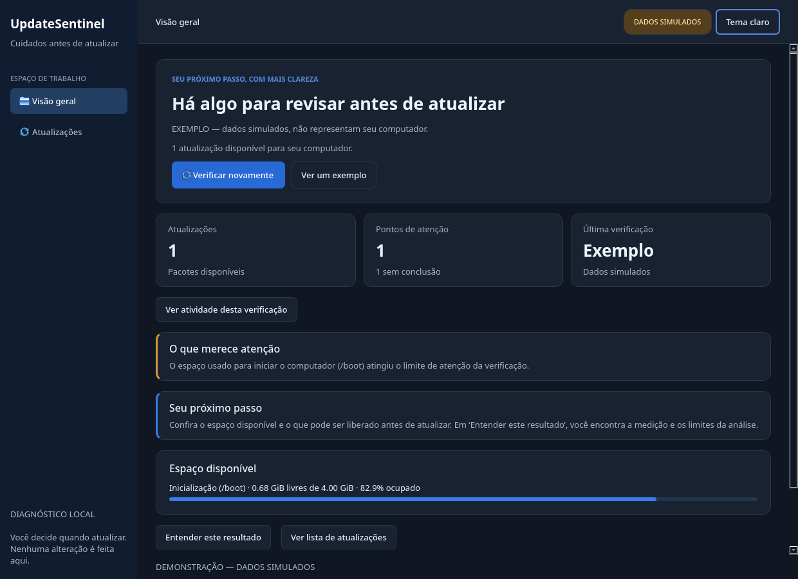

# UpdateSentinel

Quer atualizar seu Linux e entender o que precisa conferir antes?
O UpdateSentinel consulta as atualizações e mostra os cuidados encontrados em
**Arch Linux e CachyOS**, com explicações em português.

**MVP 0.1.0 — diagnóstico somente leitura. Nenhuma análise garante uma atualização segura.**

## Comece por aqui

Abra o aplicativo:

```bash
.venv/bin/updatesentinel gui
```

1. Clique em **Verificar meu computador** e aguarde.
2. Leia os três blocos: **O que foi encontrado**, **O que merece atenção** e **O que fazer agora**.
3. Use **Entender este resultado** para consultar as evidências ou **Ver lista de atualizações**
   para conferir os pacotes.

Se quiser conhecer a interface primeiro, clique em **Ver um exemplo**. Os dados desse
modo são simulados e não representam seu computador. Se uma consulta falhar, use
**Tentar novamente**; falha de consulta não significa ausência de atualizações.

Os detalhes técnicos ficam recolhidos até você clicar em **Mostrar detalhes técnicos**.
O programa orienta sua decisão: ele não instala atualizações nem libera espaço por você.
Na primeira instalação, siga os comandos da seção abaixo.

## Interface

Navegação lateral, temas claro/escuro e acompanhamento das etapas reais da verificação.
O painel mostra atualizações, alertas e informações sem conclusão separadamente.
O tempo exibido é o tempo realmente decorrido; não há porcentagem estimada de progresso.
As barras de espaço representam medições coletadas, não probabilidade de falha.



A captura mostra dados **simulados**, identificados na interface. Veja também o
[tema claro](docs/images/interface-light.png). A aparência da sessão KDE/Wayland ainda
precisa de validação interativa.

O tema começa com a preferência do sistema e pode ser alternado no topo da janela.
A escolha vale para a janela atual. Em janelas menores, a navegação se recolhe para
ícones com dicas e nomes acessíveis. Para reduzir animações, defina a variável de
ambiente `UPDATESENTINEL_REDUCED_MOTION=1` antes de abrir o aplicativo; o acompanhamento
real das etapas continua funcionando.

## O que funciona

- CLI e interface PySide6/Qt Widgets com consultas em thread, busca, categorias e ordenação.
- Visão geral com resumo e próximo passo, etapas reais de coleta e detalhes sob demanda.
- Atividade com etapas, tempo decorrido e distinção entre falha, conclusão e dados ausentes.
- Informações do computador em seções legíveis e espaço de disco medido em barras.
- Navegação lateral adaptável, temas claro/escuro e transições curtas entre telas.
- **Perguntas guiadas** sobre boot, pacotes, recuperação e recomendações com evidências.
  As respostas são determinísticas, por assuntos predefinidos; não há LLM nesta versão.
- Atualizações reais por `checkupdates`, com base temporária exclusiva e tratamento do código 2.
- Versões, descrição geral e dependências instaladas obtidas do banco local do pacman.
- Distribuição, CPU, kernel em execução, kernels com diretórios de módulos, GPUs e módulo NVIDIA.
- Espaço de `/` e `/boot`, identificando a montagem real mesmo quando `/boot` compartilha `/`.
- Detecção de configuração Limine, retenção explícita e contagem conservadora de IDs reconhecidos.
- Consulta opcional de configurações e snapshots Snapper, sem elevação de privilégios.
- Alertas determinísticos com evidência, origem, confiança, recomendação e limitações.
- Último relatório real em JSON local; modo demonstração claramente identificado e não persistido.

## Instalação no Arch/CachyOS

Requer Python 3.12+, `pacman-contrib` (`checkupdates`) e `util-linux` (`findmnt`).
`pciutils` (`lspci`) permite identificar GPUs; Snapper e Limine são opcionais.
Se faltarem dependências do sistema, instale-as pelo procedimento habitual de atualização
completa da distribuição. O aplicativo nunca instala pacotes nem pede root.

```bash
python -m venv .venv
.venv/bin/python -m pip install -e '.[gui,dev]'
.venv/bin/updatesentinel gui
```

Os comandos acima também funcionam no fish. Para instalação apenas da CLI:

```bash
.venv/bin/python -m pip install -e .
```

## Uso

```bash
.venv/bin/updatesentinel scan
.venv/bin/updatesentinel doctor
.venv/bin/updatesentinel report
.venv/bin/updatesentinel demo
.venv/bin/updatesentinel scan --json --no-save
```

`scan` acessa os repositórios configurados por meio de `checkupdates`. `doctor` não consulta
a rede. Não há pesquisa de páginas nem envio a serviços de IA. A GUI inicia sem consultar
repositórios e exige clicar em **Verificar meu computador**. O tema começa com a preferência do sistema e pode ser alternado no topo.

`scan` retorna 2 quando a consulta falha ou a distribuição não é suportada; retorna 0 para
consulta concluída, inclusive sem atualizações. `report` retorna 1 se não existir relatório.
Ausência de ferramenta opcional aparece no diagnóstico. Códigos de saída não indicam
que o sistema é seguro; leia os alertas.

O último relatório fica em `$XDG_STATE_HOME/updatesentinel/last-report.json` ou
`~/.local/state/updatesentinel/last-report.json`, com modo 0600 e gravação atômica.
`--no-save` desativa a persistência. A demonstração nunca substitui um relatório real.
Não são armazenados UUIDs, cmdlines de boot, nomes de usuário ou saídas completas de comandos.
O relatório contém inventário técnico local: revise-o antes de compartilhar.

## Limitações honestas

- Categoria de pacote é uma classificação descritiva; não prova impacto ou risco.
- Descrição e dependências são da **versão instalada**, não um changelog da versão futura.
- Não há análise da transação/dependências futuras nem compatibilidade kernel/NVIDIA validada.
- Não há suporte ao AUR, detecção de regressões, changelogs ou consulta de avisos oficiais.
- Limine instalado ou configuração encontrada não confirma qual bootloader iniciou o sistema.
- IDs de recuperação só são contados em formato reconhecido `ID=...`; outros formatos ficam
  desconhecidos. Não há verificação criptográfica ou teste de boot/restauração.
- Não há medição recursiva dos arquivos que ocupam `/boot`, detecção completa de entradas
  ausentes/corrompidas ou análise de caminhos de ESP personalizados para a regra de espaço.
  Configurações com `ESP_PATH` literal são usadas para localizar o arquivo Limine.
- Snapper pode exigir permissões que o aplicativo não solicita. A contagem exclui o estado 0.
- Os limiares de disco são preventivos, não estimativas do espaço exigido pela transação.
- O MVP não contém Ollama, SQLite, monitoramento, notificações, instalação de atualizações
  nem executor privilegiado. Nenhuma dessas funcionalidades é simulada como implementada.

## Desenvolvimento e validação

```bash
.venv/bin/ruff check .
.venv/bin/ruff format --check .
.venv/bin/pytest -q
.venv/bin/python -m build
```

A CI roda em Python 3.12/3.14 com testes simulados e Qt offscreen, sem depender do pacman.
Veja [validação local](docs/validation.md), [arquitetura](docs/architecture.md),
[desenvolvimento](docs/development.md) e [contribuição](CONTRIBUTING.md).

## Roadmap

1. **MVP:** diagnóstico, consultas reais, CLI/Qt, regras explicáveis e testes.
2. **Inteligência:** migrações SQLite, histórico, pesquisa oficial opcional, cache e Ollama
   local com saída validada. Sem execução de comandos pelo modelo.
3. **Monitoramento:** verificações periódicas, comparação de análises e notificações KDE.
4. **Prevenção:** desenho e revisão de permissões antes de qualquer ação modificadora.

PKGBUILD e capturas da sessão KDE serão adicionados após validação interativa da versão.
As capturas disponíveis acima são da interface Qt offscreen, com dados de demonstração.
O projeto não publica nem cria repositórios remotos automaticamente.

## Referências

- [Manual oficial do checkupdates](https://man.archlinux.org/man/checkupdates.8)
- [Manutenção Arch Linux](https://wiki.archlinux.org/title/System_maintenance)
- [CachyOS](https://wiki.cachyos.org/)
- [Qt for Python — QThread](https://doc.qt.io/qtforpython-6/PySide6/QtCore/QThread.html)

## Licença

Código original sob [MIT](LICENSE). Dependências são instaladas separadamente e conservam
suas licenças; PySide6/Qt possuem condições LGPL/GPL/comerciais que devem ser respeitadas
em distribuições que os incluam. Este repositório não incorpora código de terceiros.
